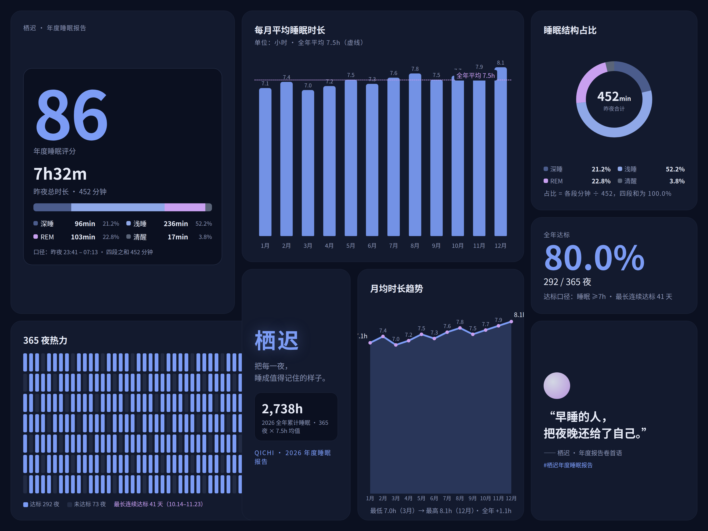
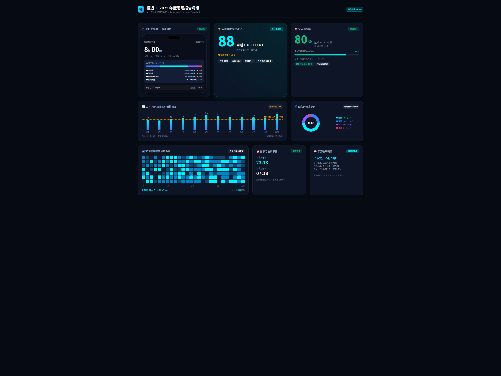
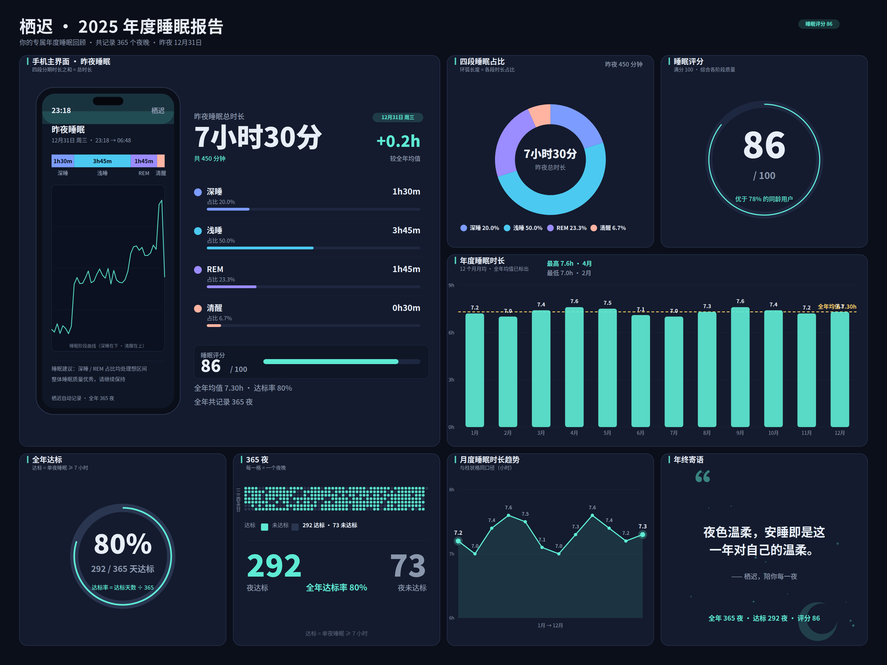

[中文](README.md) | **English**

# no-rework-ui

**A UI design workflow for AI agents: lock the key decisions first, then build**

Interface work is broken into six steps, each with a concrete deliverable and a pass bar: clarify the requirements first, pick a direction, lock colors, type sizes and spacing into one token table that every later page follows, and finish with screenshot-by-screenshot acceptance. You do not need design experience — every decision point in the flow is a multiple-choice question; pick one and it moves on.

▶ **See it first**: [the Qichi three-way comparison](examples/qichi-sleep-report/) (one brief, three AIs, each running this workflow independently, all passing acceptance) · [the motion-shelf test page](examples/aimran-shengji/) (live version: https://lzwmt.com/aimran-test/ — open it on a phone and tap through the animations)

# What this is

Drop this folder into your agent's skills directory and say "build this page with ui-workflow" — it starts from the step-one questions.

The six steps:

1. Clarify: what to build, who it is for, which features are needed now and which can wait — written up as a one-page brief.
2. Sample: three design directions, first screen only; pick one, or combine the parts you like.
3. Lock the chosen direction into design tokens — colors, type scale, spacing, radii — shared by every page from then on.
4. Build one page completely as the master; later pages reuse its components. Promo stills, animations and Bento boards are derived from the same components and the same data.
5. Accept by screenshot: one desktop and one mobile capture, every word and number on the page checked item by item, fixes tracked as a change list.
6. Ship after review, then open the live page once to confirm.

What comes in the box:

- **Density check**: every grid cell gets a content list with a minimum quota up front; afterwards `scripts/density_check.py` measures how full each cell actually is — the numbers decide, and the boards come out full.
- **Numbers that reconcile**: every figure on a board is generated from a single data source, so shares, averages and totals agree with each other and can be re-derived at acceptance time.
- **Motion shelf**: at step 4, motion comes from `references/aimran-picks.md` first — 24 picks curated from AIMRAN Library's 814 free animated components, indexed by scenario (buttons, loaders, cards, toasts, toggles, text), each with where to use it, where to get the code, and how it triggers on mobile. Take a ready-made piece and re-token it to the project instead of hand-writing motion from scratch.
- **Templates included**: brief and change-request templates live in `templates/` — fill in the blanks and start.
- **Agent-agnostic**: a single agent can run it end to end; if other design skills are installed in the environment, it calls them at the matching step instead of competing with them.

## Changelog

- **Motion shelf (v1.7, 2026-11-10)**: new `references/aimran-picks.md` (24 picks from AIMRAN Library's 814 components) and hard rule 12: on the hand-written route, motion is taken from the index first, must be re-tokened to the project, hover-only pieces get a mobile trigger, and each page gets only one hero effect; hand-write only what the index lacks. Field-tested twice: once as a preview on a real product page (4 pieces, recolored to the project's tokens, verified with real-browser screenshots), and once as an independent validation run — an agent that had no part in writing the index built a landing page for a fictional transcription tool using only indexed pieces, used 7 of them, and passed data-consistency and real-browser acceptance. The result lives in [examples/aimran-shengji/](examples/aimran-shengji/).
- **Implementation routes (v1.4)**: step one now picks an implementation route per page type. Admin/workspace pages in a new React 19 project follow the **Astryx design-system route**: 150+ accessible components and ready-made themes, component-first implementation with a CLI contract check before coding, and a component list plus bundle-size readout at acceptance. See `references/astryx-route.md`.
- **Mini-program / multi-platform route (v1.5)**: projects targeting mini-programs, or shipping one codebase to mini-programs + H5 + apps, follow the **uni-app route**: an app-category review check before starting, a locked component-library choice, per-platform build artifacts and main-package size at acceptance, and a platform-review checklist for launch. The plugin marketplace is an optional step with a candidate list before any adoption. See `references/uni-app-route.md`.
- **Step 2 completed (v1.6)**: after a direction is picked, multi-page projects expand every page into a high-fidelity static mock for confirmation, and pages with motion get a runnable motion sample with parameterized values before anything is locked. The lock is now three parts: tokens + per-page look + motion parameters, and implementation is delivered page-by-page against the locked mocks.

## Showcase

One full run: the same brief (an annual-report board plus a short silent video for a fictional sleep app, "Qichi") given to three different AIs, each working independently with this workflow.

By magic:

▶ [Watch magic's video](examples/qichi-sleep-report/magic/video.mp4)

By pi + Gemini 3.8 Flash:

▶ [Watch pi + 3.8's video](examples/qichi-sleep-report/pi-gemini-3.8-flash/video.mp4)

By pi + WorkBuddy hy3:

▶ [Watch pi + hy3's video](examples/qichi-sleep-report/pi-hy3/video.mp4)

Comparison (same acceptance yardstick for all three: re-derivation from the data source, density-script readings, frame checks):

| | magic | pi + 3.8 | pi + hy3 |
|---|---|---|---|
| Figure consistency | 4/4 ✔ (total 452 min) | 4/4 ✔ (total 480 min) | 4/4 ✔ (total 450 min) |
| Cell density (all cells pass) | ✔ min 0.054 | ✔ min 0.067 | ✔ min 0.069 |
| Video | 8.5s, all three beats | 8.0s, all three beats | 8.0s, real curve draw-in + minute counter |
| Strongest point | Steadiest composition | Page code closest to a real project — ready to build on | Highest finish and richest data |

Each of the three invented its own data independently, yet every share, average and pass rate re-derives exactly from its source. More detail in [examples/qichi-sleep-report/](examples/qichi-sleep-report/).

## Files

- `SKILL.md` — the controller; the full six-step rules are in `references/gates.md`
- `references/astryx-route.md` — the Astryx route for React 19 admin pages; `references/uni-app-route.md` — the uni-app route for mini-program / multi-platform projects
- `references/aimran-picks.md` — the motion shelf: 24 curated AIMRAN Library picks, indexed by scenario
- `references/` — the rest: composition, type & tokens, density, sampling, review
- `templates/` — brief and change-request templates
- `scripts/density_check.py` — the density measurement script
- `examples/` — two full field tests: the Qichi three-way comparison and the Shengji motion-shelf validation
