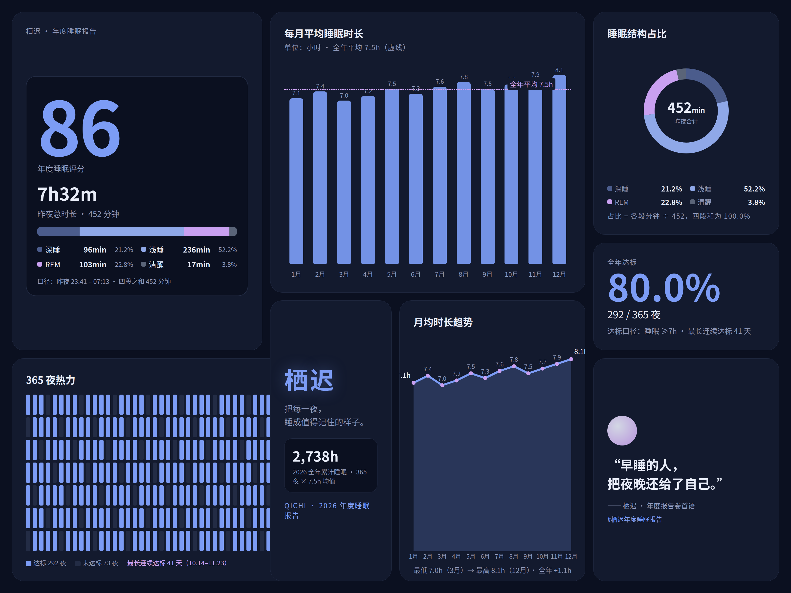
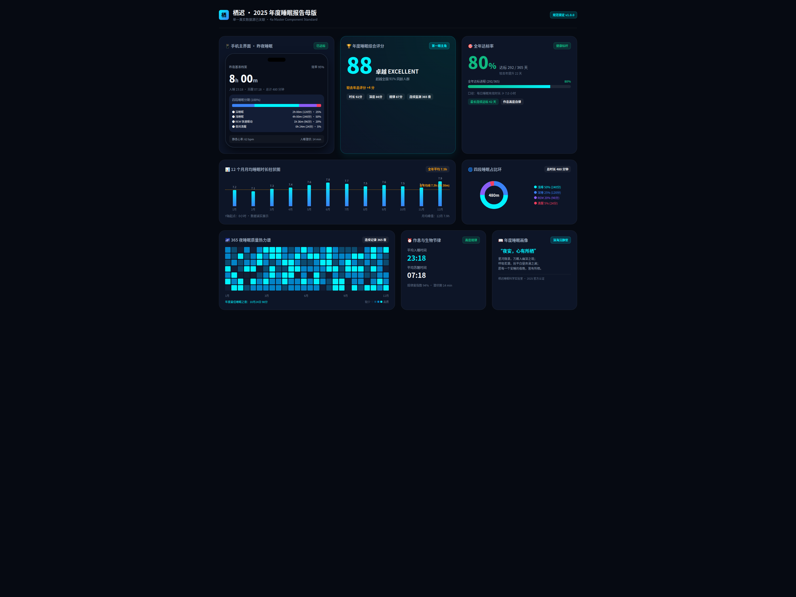
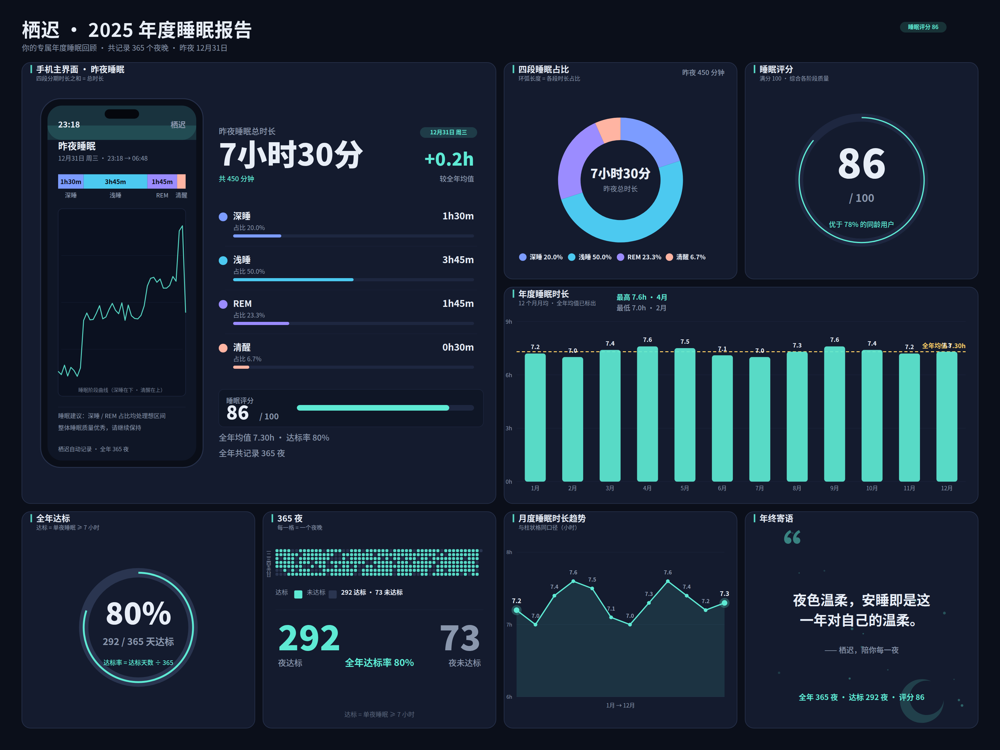

[中文](README.md) | **English**

# What this is

ui-workflow is a UI design workflow for AI agents. It breaks interface work into six steps, each with a concrete deliverable and a pass bar: clarify the requirements first, pick a direction, lock colors, type sizes and spacing into one token table that every later page follows, and finish with screenshot-by-screenshot acceptance. You do not need design experience — every decision point in the flow is a multiple-choice question; pick one and it moves on.

Drop this folder into your agent's skills directory and say "build this page with ui-workflow" — it starts from the step-one questions.

The six steps:

1. Clarify: what to build, who it is for, which features are needed now and which can wait — written up as a one-page brief.
2. Sample: three design directions, first screen only; pick one, or combine the parts you like.
3. Lock the chosen direction into design tokens — colors, type scale, spacing, radii — shared by every page from then on.
4. Build one page completely as the master; later pages reuse its components. Promo stills, animations and Bento boards are derived from the same components and the same data.
5. Accept by screenshot: one desktop and one mobile capture, every word and number on the page checked item by item, fixes tracked as a change list.
6. Ship after review, then open the live page once to confirm.

What comes in the box:

- **Density check**: every grid cell gets a content list with a minimum quota up front; afterwards `scripts/density_check.py` measures how full each cell actually is — the numbers decide, and the boards come out full.
- **Numbers that reconcile**: every figure on a board is generated from a single data source, so shares, averages and totals agree with each other and can be re-derived at acceptance time.
- **Templates included**: brief and change-request templates live in `templates/` — fill in the blanks and start.
- **Agent-agnostic**: a single agent can run it end to end; if other design skills are installed in the environment, it calls them at the matching step instead of competing with them.

## Showcase

One full run: the same brief (an annual-report board plus a short silent video for a fictional sleep app, "Qichi") given to three different AIs, each working independently with this workflow.

By magic:

▶ [Watch magic's video](examples/qichi-sleep-report/magic/video.mp4)

By pi + Gemini 3.8 Flash:

▶ [Watch pi + 3.8's video](examples/qichi-sleep-report/pi-gemini-3.8-flash/video.mp4)

By pi + WorkBuddy hy3:

▶ [Watch pi + hy3's video](examples/qichi-sleep-report/pi-hy3/video.mp4)

Comparison (same acceptance yardstick for all three: re-derivation from the data source, density-script readings, frame checks):

| | magic | pi + 3.8 | pi + hy3 |
|---|---|---|---|
| Figure consistency | 4/4 ✔ (total 452 min) | 4/4 ✔ (total 480 min) | 4/4 ✔ (total 450 min) |
| Cell density (all cells pass) | ✔ min 0.054 | ✔ min 0.067 | ✔ min 0.069 |
| Video | 8.5s, all three beats | 8.0s, all three beats | 8.0s, real curve draw-in + minute counter |
| Strongest point | Steadiest composition | Page code closest to a real project — ready to build on | Highest finish and richest data |

Each of the three invented its own data independently, yet every share, average and pass rate re-derives exactly from its source. More detail in [examples/qichi-sleep-report/](examples/qichi-sleep-report/).

## Files

- `SKILL.md` — the controller; the full six-step rules are in `references/gates.md`
- `references/` — the rest: composition, type & tokens, density, sampling, review
- `templates/` — brief and change-request templates
- `scripts/density_check.py` — the density measurement script
