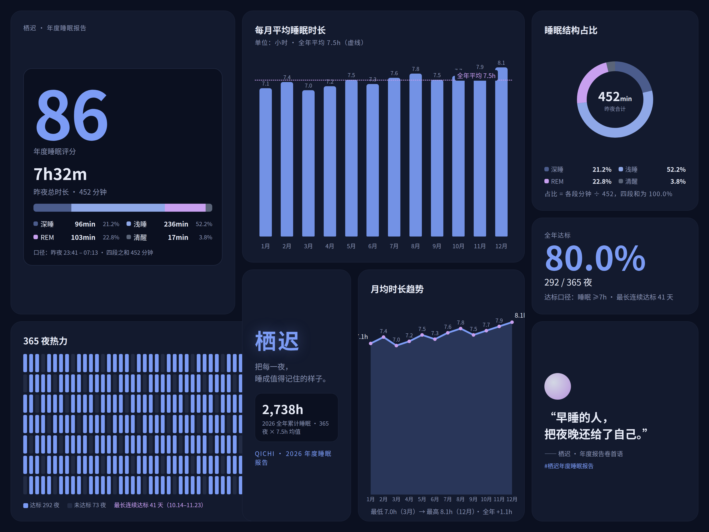
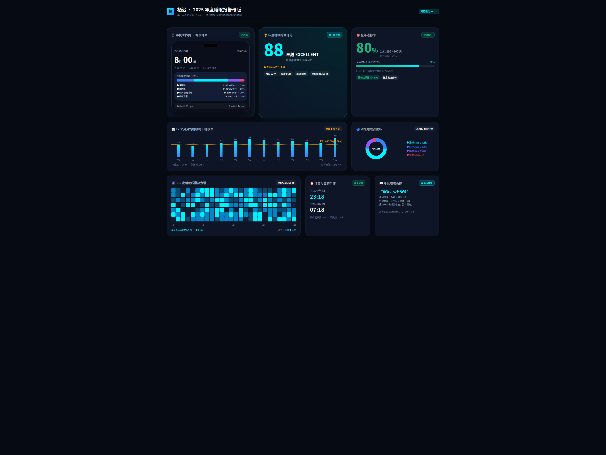
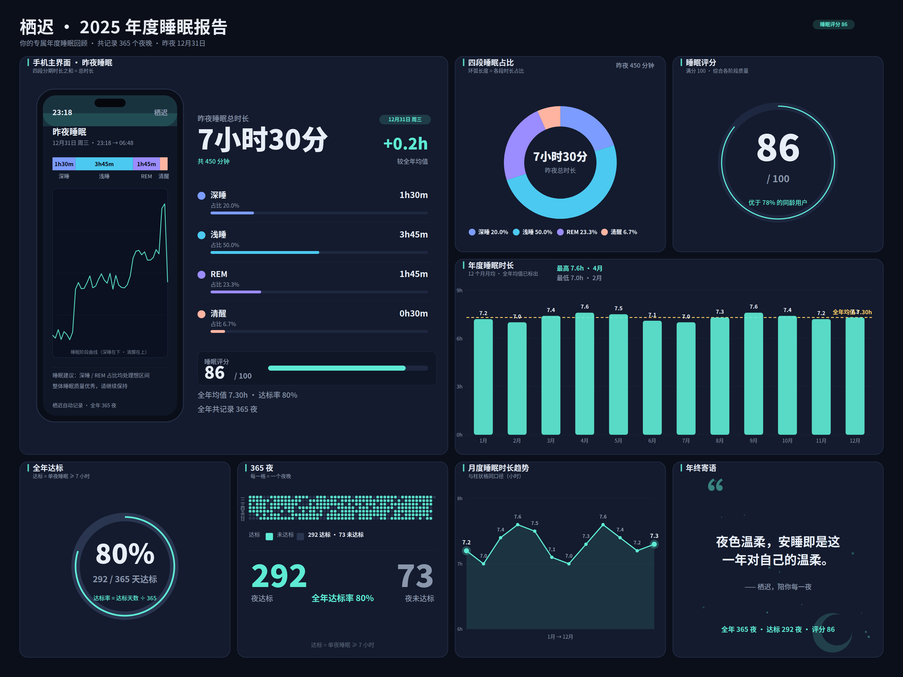

**中文** | [English](README.en.md)

# no-rework-ui

**给 AI agent 用的 UI 设计流程：先把关键决定锁死，再动手做界面**

把做界面拆成六步，每一步都有明确的产物和过关标准：先把需求问清楚，选好方向，再把颜色、字号、间距定成一张表，后面的页面都照着这张表做，最后拿截图逐项验收。使用者不需要懂设计，流程里要拍板的地方都是选择题，选完就往下走。

▶ **先看效果**：[栖迟三方对照案例](examples/qichi-sleep-report/)（同一道题，三个 AI 各用这套流程做了一遍，全过验收） · [动效货架实测页](examples/aimran-shengji/)（在线版：https://lzwmt.com/aimran-test/ ，手机打开可直接点着看动效）

# 这是什么

把这个文件夹放进 agent 的技能目录，跟它说一句「按 ui-workflow 做这个页面」，它就会从第一步的提问开始。

六步是这样：

1. 问清楚需求：做什么、给谁用、哪些功能现在就要、哪些以后再说，写成一页简报。
2. 出三个方向的小样，只做首屏，选一个，或者挑几个方向里喜欢的部分组合。
3. 把选中的方向定成设计表（design tokens）：颜色、字号、间距、圆角都在里面，之后所有页面共用。
4. 先把一个页面做透当母版，后面的页面复用它的组件；宣传图、动画、Bento 也用同一套组件和同一份数据来做。
5. 截图验收：桌面和手机各一张，图上的文字和数字逐项核对，按修改单一条条改。
6. 审查通过后上线，上线后再打开真实页面确认一次。

配套的现成东西：

- **密度检查**：每格画面先列内容清单、定好下限，做完拿 `scripts/density_check.py` 量一遍每格的充实程度，有读数才算数，出来的图是饱满的。
- **数字对得上账**：一张图里的数字从同一个数据源生成，占比、均值、总数互相咬合，验收时可以逐项重算验证。
- **动效货架**：第 4 步加动效先查 `references/aimran-picks.md`——从 AIMRAN Library 的 814 个免费动效组件里精选 24 件，按按钮、等待、卡片、提示、开关、文字六类场景编成索引，每件写明用在什么场合、取件地址、手机端怎么触发；取现成件改成本项目的设计表，不再从零手写。
- **模板齐全**：简报、修改单模板在 `templates/`，拿来填空就能开工。
- **不挑 agent**：单个 agent 能从头跑到尾；环境里装了其他设计技能，它只在对口的步骤调用，不抢活。

## 更新记录

- **动效货架（v1.7，2026-11-10）**：新增 `references/aimran-picks.md` 精选索引（AIMRAN Library 814 件筛 24 件）与硬规矩 12：手写路线加动效先查索引取现成件、进项目必改 tokens、hover 独占件改手机端触发方式、每页只许一个主特效位，索引没有的才手写。已实测两轮：一轮真实项目页面预览（4 件上页、按项目 tokens 改色、真浏览器截图验收）；一轮独立 agent 验证单——只许用索引内的件，给虚构的录音转文字工具做落地页，用足 7 件，数据自洽与真浏览器验收通过，成品在 [examples/aimran-shengji/](examples/aimran-shengji/)。
- **实现路线判定（v1.4）**：第一步就按页面类型定实现路线。其中新建 React 19 项目的后台/工作区页走 **Astryx 设计系统路线**：150+ 无障碍组件与现成主题，选主题代替从零定样式，实现时组件优先、用它自带的 CLI 先查组件契约再写代码，验收时交组件清单和产物体积读数。细则在 `references/astryx-route.md`。
- **小程序 / 多端路线（v1.5）**：目标包含小程序、或要小程序 + H5 + App 一套代码多端同发的项目，走 **uni-app 路线**：开工前先核类目能否过审，实现前锁定组件库选型，验收交各端构建产物与主包体积读数，上线按平台审核清单逐项过。插件市场备有现成模板可选，流程里是一个可选步，用不用先列候选表再决定。细则在 `references/uni-app-route.md`。
- **第 2 步补全（v1.6）**：方向选定后，多页项目把每一页都扩成高保真静态稿逐页确认；有动效的页面先做一份能实际运行的动效样张，参数写成变量，看过效果才锁定。第 3 步的锁定也从一份设计表扩成三件：设计表 + 每页长相 + 动效参数；后面写代码逐页对照交付。

## 效果展示

一次完整实测：同一道题（虚构睡眠 App「栖迟」的年度报告图加短视频），三个不同的 AI 互不知情、各用这套流程做了一遍。

magic 的成品：

▶ [看 magic 的视频](examples/qichi-sleep-report/magic/video.mp4)

pi ＋ Gemini 3.8 Flash 的成品：

▶ [看 pi ＋ 3.8 的视频](examples/qichi-sleep-report/pi-gemini-3.8-flash/video.mp4)

pi ＋ WorkBuddy hy3 的成品：

▶ [看 pi ＋ hy3 的视频](examples/qichi-sleep-report/pi-hy3/video.mp4)

对比结果（三家同一口径验收：数据源重算 ＋ 密度脚本读数 ＋ 抽帧核对）：

| | magic | pi ＋ 3.8 | pi ＋ hy3 |
|---|---|---|---|
| 数字勾连 | 4/4 ✔（总时长 452 分） | 4/4 ✔（总时长 480 分） | 4/4 ✔（总时长 450 分） |
| 格子密度（全格通过） | ✔ 最低 0.054 | ✔ 最低 0.067 | ✔ 最低 0.069 |
| 视频 | 8.5 秒，三拍完整 | 8.0 秒，三拍完整 | 8.0 秒，真曲线推进 ＋ 累计分钟计数 |
| 最强项 | 构图最稳 | 页面代码最接近真实项目，能直接接着开发 | 图面完成度与信息量最高 |

三家的数字口径各自独立，却都严丝合缝，占比、均值、达标率全部能从数据源一步重算对上。更多细节在 [examples/qichi-sleep-report/](examples/qichi-sleep-report/)。

## 文件

- `SKILL.md` 是总控，六步的完整规矩在 `references/gates.md`
- `references/astryx-route.md` 是 React 19 后台页的 Astryx 路线细则，`references/uni-app-route.md` 是小程序/多端项目的 uni-app 路线细则
- `references/aimran-picks.md` 是动效货架精选索引（AIMRAN Library 24 件，按场景取件）
- `references/` 其余几份是构图、字号与 tokens、密度、出样、验收的细则
- `templates/` 是简报和修改单模板
- `scripts/density_check.py` 是密度检查脚本
- `examples/` 是两个完整实测案例：栖迟三方对照、声记动效货架验证单
