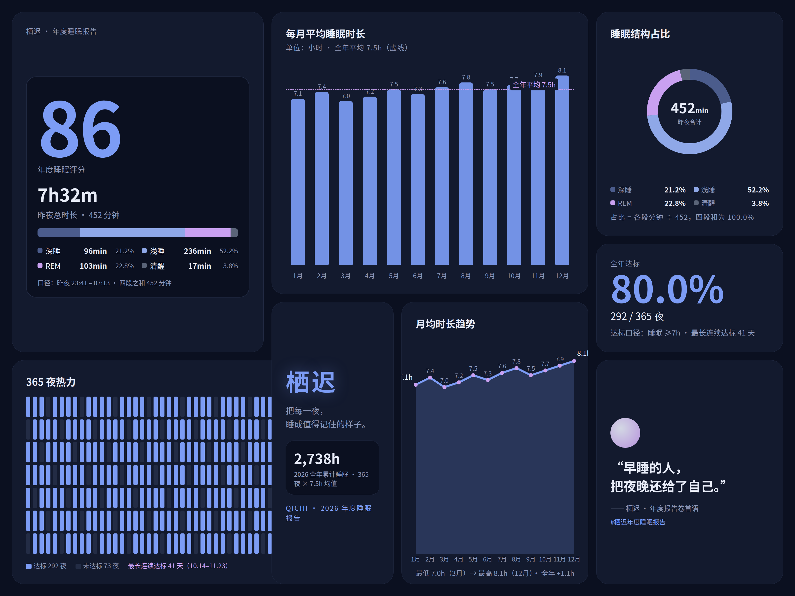

**中文** | [English](README.en.md)

# 这是什么

ui-workflow 是一套给 AI agent 用的 UI 设计流程。把做界面拆成六步，每一步都有明确的产物和过关标准：先把需求问清楚，选好方向，再把颜色、字号、间距定成一张表，后面的页面都照着这张表做，最后拿截图逐项验收。使用者不需要懂设计，流程里要拍板的地方都是选择题，选完就往下走。

把这个文件夹放进 agent 的技能目录，跟它说一句「按 ui-workflow 做这个页面」，它就会从第一步的提问开始。

六步是这样：

1. 问清楚需求：做什么、给谁用、哪些功能现在就要、哪些以后再说，写成一页简报。
2. 出三个方向的小样，只做首屏，选一个，或者挑几个方向里喜欢的部分组合。
3. 把选中的方向定成设计表（design tokens）：颜色、字号、间距、圆角都在里面，之后所有页面共用。
4. 先把一个页面做透当母版，后面的页面复用它的组件；宣传图、动画、Bento 也用同一套组件和同一份数据来做。
5. 截图验收：桌面和手机各一张，图上的文字和数字逐项核对，按修改单一条条改。
6. 审查通过后上线，上线后再打开真实页面确认一次。

配套的现成东西：

- **密度检查**：每格画面先列内容清单、定好下限，做完拿 `scripts/density_check.py` 量一遍每格的充实程度，有读数才算数，出来的图是饱满的。
- **数字对得上账**：一张图里的数字从同一个数据源生成，占比、均值、总数互相咬合，验收时可以逐项重算验证。
- **模板齐全**：简报、修改单模板在 `templates/`，拿来填空就能开工。
- **不挑 agent**：单个 agent 能从头跑到尾；环境里装了其他设计技能，它只在对口的步骤调用，不抢活。

## 效果展示

一次完整实测：同一道题（虚构睡眠 App「栖迟」的年度报告图加短视频），三个不同的 AI 互不知情、各用这套流程做了一遍。

magic 的成品：

▶ [看 magic 的视频](examples/qichi-sleep-report/magic/video.mp4)

pi ＋ Gemini 3.8 Flash 的成品：

▶ [看 pi ＋ 3.8 的视频](examples/qichi-sleep-report/pi-gemini-3.8-flash/video.mp4)

pi ＋ WorkBuddy hy3 的成品：

▶ [看 pi ＋ hy3 的视频](examples/qichi-sleep-report/pi-hy3/video.mp4)

对比结果（三家同一口径验收：数据源重算 ＋ 密度脚本读数 ＋ 抽帧核对）：

| | magic | pi ＋ 3.8 | pi ＋ hy3 |
|---|---|---|---|
| 数字勾连 | 4/4 ✔（总时长 452 分） | 4/4 ✔（总时长 480 分） | 4/4 ✔（总时长 450 分） |
| 格子密度（全格通过） | ✔ 最低 0.054 | ✔ 最低 0.067 | ✔ 最低 0.069 |
| 视频 | 8.5 秒，三拍完整 | 8.0 秒，三拍完整 | 8.0 秒，真曲线推进 ＋ 累计分钟计数 |
| 最强项 | 构图最稳 | 页面代码最接近真实项目，能直接接着开发 | 图面完成度与信息量最高 |

三家的数字口径各自独立，却都严丝合缝，占比、均值、达标率全部能从数据源一步重算对上。更多细节在 [examples/qichi-sleep-report/](examples/qichi-sleep-report/)。

## 文件

- `SKILL.md` 是总控，六步的完整规矩在 `references/gates.md`
- `references/` 其余几份是构图、字号与 tokens、密度、出样、验收的细则
- `templates/` 是简报和修改单模板
- `scripts/density_check.py` 是密度检查脚本
