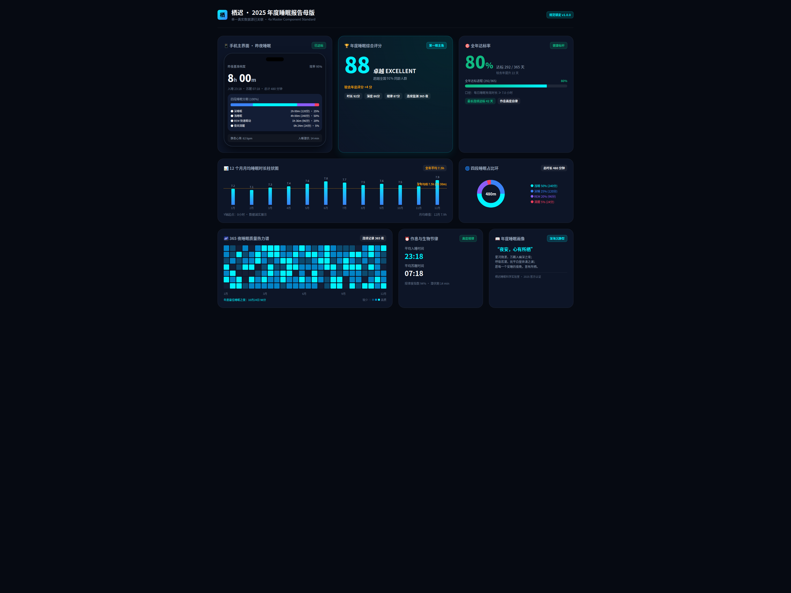
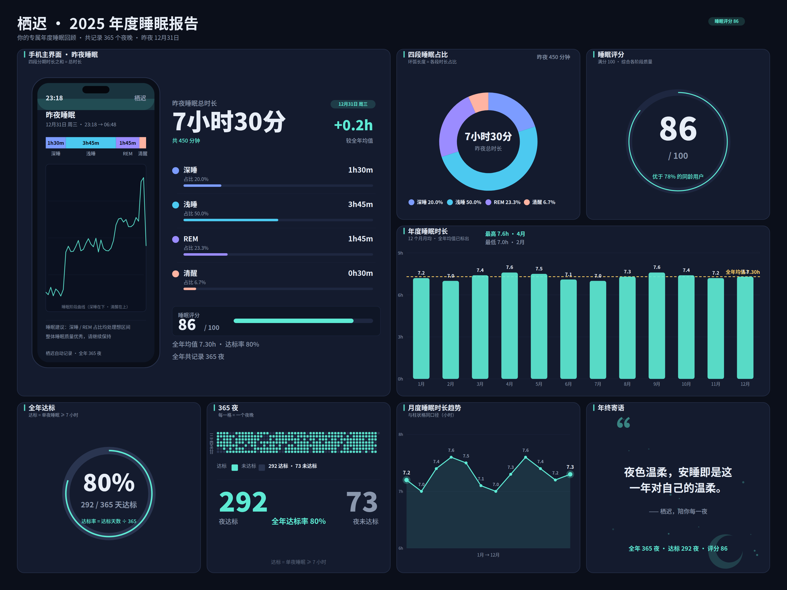

# 栖迟同题三方对照：同一道 UI 题，三个 AI 执行者

同一道题、同一个技能、互不知情：为虚构睡眠 App「栖迟」做「年度睡眠报告」展示物料——深色主题 Bento 静图（≥7 格）＋ 1280×720 无声短动画（三拍：入夜 → 睡眠曲线 → 清晨评分）。三方都只许用 **ui-workflow** 技能（v1.3 密度调优版），禁用 stageshow；数据可自拟，但四条勾连必须严格成立：

1. 四段分期时长之和 ＝ 总时长
2. 四段占比之和 ＝ 100%，且每段占比与时长比例一致
3. 12 个月柱值之平均 ＝ 所标全年平均
4. 达标率 ＝ 达标天数 ÷ 365

完整简报见 [brief.md](brief.md)。验收口径统一：直读数据源重算勾连、density.json 直读核对、ffprobe ＋ 抽帧验视频、肉眼看图查标签碰撞。

## 成品并排

| magic（Hermes） | pi ＋ Gemini 3.8 Flash | pi ＋ WorkBuddy hy3 |
|---|---|---|
|  |  |  |

视频：[magic](magic/video.mp4) · [pi ＋ Gemini 3.8 Flash](pi-gemini-3.8-flash/video.mp4) · [pi ＋ hy3](pi-hy3/video.mp4)

## 结果总表

| | magic | pi ＋ 3.8 | pi ＋ hy3 |
|---|---|---|---|
| 交付过程 | 一遍过（密度 2 格 FAIL 自修） | 两次响应截断，靠协调者 5 个微步磨完 | 一遍过、零干预（约 37 分钟） |
| 静图 | 3200×2400，8 格 | 3200×2400，8 格 | 3200×2400，8 格 |
| 四条勾连（数据源重算） | 4/4 ✔（总 452 分，占比带零头） | 4/4 ✔（总 480 分，占比全整数） | 4/4 ✔（总 450 分） |
| 密度最低 ink | 0.054（贴线） | 0.067 | 0.069，多格 ≥0.1（三方最稳） |
| 视频 | 8.5s，三拍齐 | 8.0s，第二拍以分段条代曲线 | 8.0s，真曲线推进＋累计分钟计数 |
| 视觉缺陷 | 2 处标签碰撞 | 未见碰撞；留白偏多 | 1 处：12 月柱值被均值标注遮盖 |
| 文档可信度 | DONE 与数据源一致 | DONE 与数据源一致 | DONE 数字清单两处转写错误（图与数据本身正确） |

## 三方共同的问题

1. **数据都是「先定目标、再反推」**：三家达标率都正好 292/365＝80%，均值先定好再配月值。勾连「必然成立」——验算只能证明算术对，证明不了数据像真的。
2. **图表标注没人避让**：均值标注压柱值，magic 中两处、hy3 中一处；密度脚本只量墨水、不查标签重叠。
3. **寄语格是共同的稀疏格**：三方最稀的格都是文字格言格，贴着阈值过线。
4. **365 夜热力格都是装饰**：只保证达标计数（292/73）是真的，每夜数值不承载可验算信息。
5. **长得像一家人**：同一技能、同一套标杆，三套版式语法高度趋同。

## 可落地性：好看 ≠ 能用

直读三家页面源码后的结论——**可落地性由交付介质决定，不由图面质量决定**：

| | magic | pi ＋ 3.8 | pi ＋ hy3 |
|---|---|---|---|
| 源码介质 | 真 HTML/CSS，12 列网格 | 真 HTML，宽 1440px（真实桌面视口） | HTML 壳内嵌一整张 SVG |
| 布局方式 | grid＋flex，绝对定位 16 处 | flex 为主、绝对定位 2 处，带 1 档响应式断点 | 无 CSS 布局（矢量坐标） |
| tokens | 13 个 CSS 变量，文档 27 行 | 19 个语义命名变量，文档 90 行 | 页面内 0 变量，文档 65 行 |
| 数据源 | data.json | data.json（嵌套、最像真接口） | data.py 常量 |
| 可落地评级 | 中：结构可搬，尺寸是海报像素需整体缩放 | **最高**：真宽度＋流式布局＋断点，可近乎直接作起点 | 最低：SVG 只能当图片资产，页面须从零重写 |

图面第一的 hy3，代码可落地性垫底；过程最狼狈的 3.8，反而唯一做出了真页面骨架。三家共同的可落地资产是技能关 3 逼出来的 design tokens 与单一数据源。教训：要落地，简报必须直接规定交付介质（真实视口宽度、HTML＋CSS 变量、至少一档断点）；不规定，执行者必然选最容易出图效果的固定画布或 SVG。

## 过程教训

- 3.8 在 pi 长任务里有**长响应截断**的稳定性问题（整段续跑同样截断），单命令/单文件的微步分段可以绕过。
- 验收**不能信自报清单**：hy3 的 DONE 把 12 个月数值整段转写错了——勾连验算必须以数据源文件为准，DONE 只作索引。
