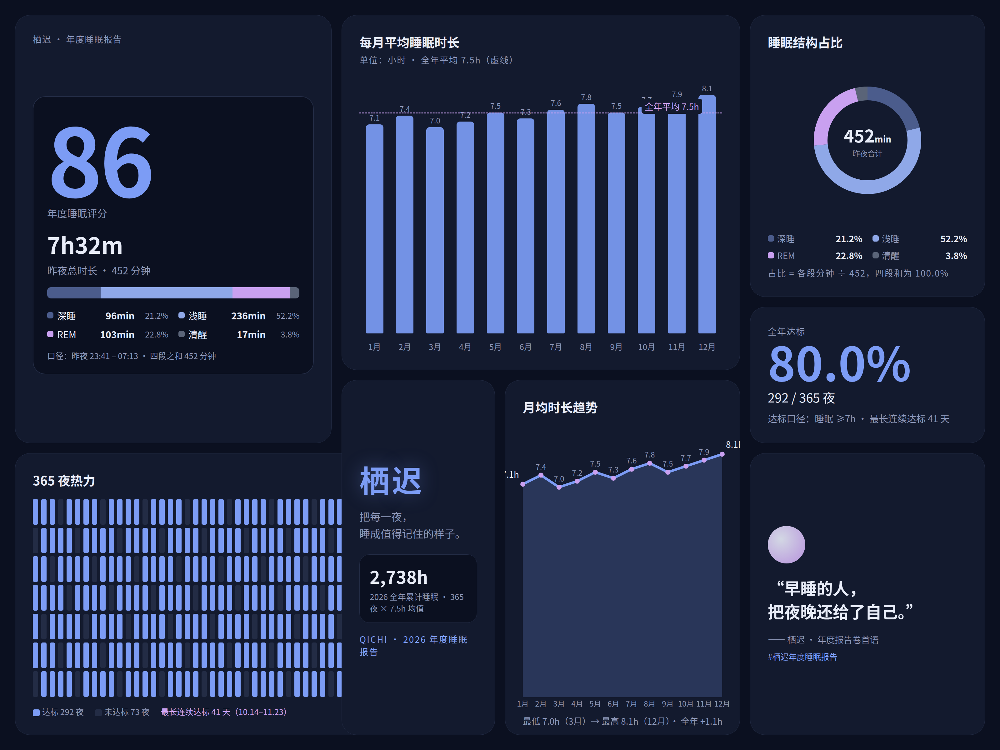
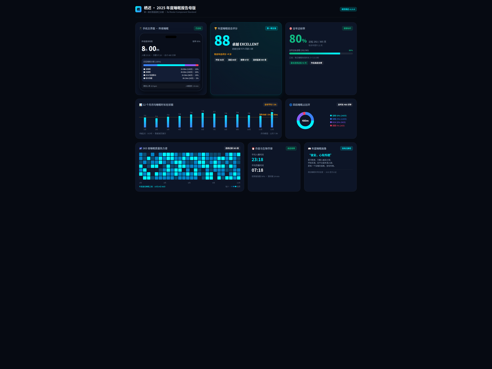
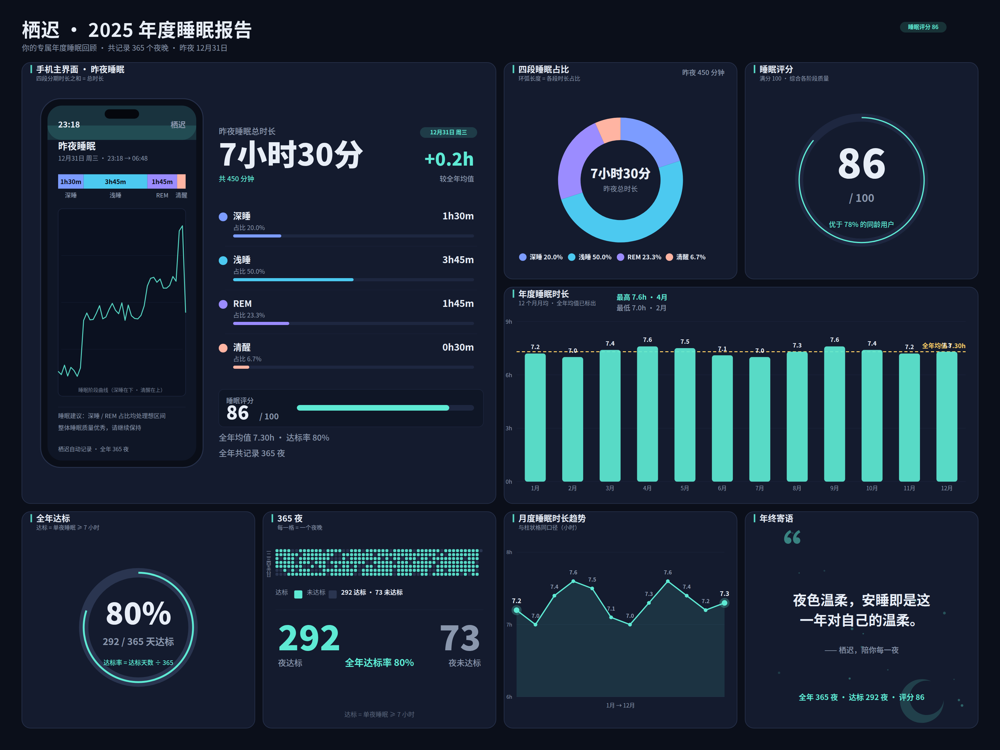

# 案例：栖迟年度睡眠报告（例题实测）

一道例题，验证 ui-workflow 在不同执行者手里是否稳定收敛。题目：为虚构睡眠 App「栖迟」做「年度睡眠报告」展示物料——深色主题 Bento 静图（≥7 格，四格必含）＋ 1280×720 无声短动画（三拍：入夜 → 睡眠曲线 → 清晨评分）。三方互不知情、只许用 ui-workflow（v1.3）、禁 stageshow；数据可自拟，但四条勾连必须成立：分段和＝总时长、占比和＝100% 且与时长比一致、12 月均值＝全年平均、达标率＝达标天数÷365。完整简报见 [brief.md](brief.md)。

执行者：magic（Hermes）、pi ＋ Gemini 3.8 Flash、pi ＋ WorkBuddy hy3。验收口径统一：直读数据源重算勾连、density.json 直读、ffprobe ＋ 抽帧、肉眼查标签碰撞。

## 成品并排

| magic | pi ＋ 3.8 | pi ＋ hy3 |
|---|---|---|
|  |  |  |

视频：[magic](magic/video.mp4) · [pi ＋ 3.8](pi-gemini-3.8-flash/video.mp4) · [pi ＋ hy3](pi-hy3/video.mp4)

## 结果

| | magic | pi ＋ 3.8 | pi ＋ hy3 |
|---|---|---|---|
| 交付过程 | 一遍过（密度 2 格 FAIL 自修） | 两次响应截断，靠协调者微步磨完 | 一遍过、零干预（约 37 分钟） |
| 四条勾连（数据源重算） | 4/4 ✔（总 452 分） | 4/4 ✔（总 480 分，占比全整数） | 4/4 ✔（总 450 分） |
| 密度最低 ink | 0.054（贴线） | 0.067 | 0.069（三方最稳） |
| 视频 | 8.5s，三拍齐 | 8.0s，第二拍以分段条代曲线 | 8.0s，真曲线推进＋累计分钟 |
| 视觉缺陷 | 2 处标签碰撞 | 未见碰撞，留白偏多 | 1 处标签遮盖 |
| 文档可信度 | DONE 与数据源一致 | DONE 与数据源一致 | DONE 数字清单两处转写错误（图与数据正确） |

## 共同问题（三方全中）

1. **数据「先定目标再反推」**：达标率都正好 292/365＝80%，均值先定好再配月值——勾连必然成立，验算只能证明算术对。
2. **图表标注不避让**：均值标注压柱值，magic 两处、hy3 一处；密度脚本不查标签重叠。
3. **寄语格共同稀疏**：三方最稀的格都是文字格言格，贴阈值过线。
4. **365 夜热力格装饰化**：只保证达标计数真，每夜数值不承载可验算信息。
5. **版式趋同**：同技能同标杆，三套图长得像一家人。

## 可落地性（直读源码）

| | magic | pi ＋ 3.8 | pi ＋ hy3 |
|---|---|---|---|
| 介质 | 真 HTML，12 列网格 | 真 HTML，宽 1440px（真实视口） | HTML 壳内嵌整张 SVG |
| 可落地评级 | 中：结构可搬，尺寸是海报像素 | **最高**：流式布局＋1 档断点，可近乎直接作起点 | 最低：SVG 只能当图片资产 |

结论：可落地性由交付介质决定，不由图面质量决定。要真页面，简报里必须写死介质规格；共同的可落地资产是关 3 的 tokens 与单一数据源。

## 过程教训

- 长响应截断是通道稳定性问题，与产出能力无关；微步分段（单命令/单文件）可绕过，但改变了「一遍过」的对照口径。
- 验收不能信自报清单：勾连必须从数据源重算，交付说明只作索引。
